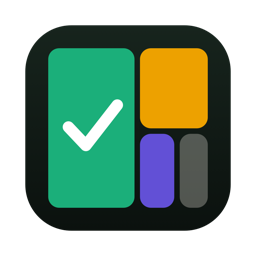
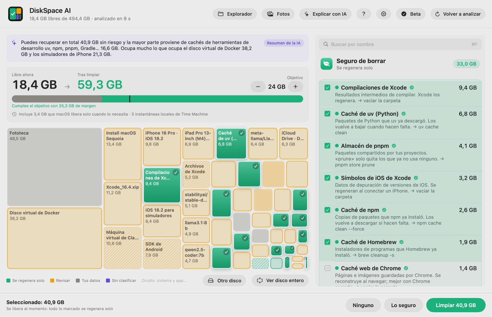

<p align="center"></p>
<h1 align="center">DiskSpace AI</h1>
<p align="center"><b>Libera espacio en tu Mac sin miedo.</b><br>
Te dice qué es cada carpeta y solo marca lo que se regenera solo. Tus archivos se apartan 7 días, por si te equivocas.</p>
<p align="center">
  <a href="https://diskspaceai.com/download"></a>
  
  
  <a href="https://diskspaceai.com/es/beta"></a>
</p>
<p align="center">
  <a href="https://diskspaceai.com/es/"><b>Web</b></a> ·
  <a href="https://diskspaceai.com/es/beta"><b>Descargar la beta</b></a> ·
  <a href="https://diskspaceai.com/es/#demo">Demo interactiva</a> ·
  <a href="mcp/README.es.md">Para agentes de IA (MCP)</a> ·
  <a href="README.md">English</a>
</p>

<p align="center"></p>

Este repositorio es la **documentación pública** de DiskSpace AI: el catálogo de carpetas que conoce la app, cómo conectarla con tu agente de IA, las novedades y el sitio para avisar de errores o pedir mejoras. La app no es de código abierto.

## Qué hace

- **Sabe qué es cada carpeta.** Cachés de uv, npm, pnpm y Homebrew, compilaciones de Xcode, node_modules de proyectos parados, Docker, modelos de IA, simuladores, instaladores que ya usaste… Las que no conoce te las explica la IA de Apple, en tu Mac.
- **Cuatro colores, una regla.** Verde se regenera solo y viene marcado; ámbar se revisa; gris son tus datos y solo se enseñan; morado está sin clasificar.
- **Con red.** Lo que se regenera solo se borra al momento; lo tuyo se aparta 7 días y se puede deshacer.
- **Fotos duplicadas y parecidas.** En tu fototeca y en tus carpetas: duplicados exactos, fotos casi iguales (Vision de Apple elige la mejor, en tu Mac), capturas viejas, vídeos grandes y ráfagas.
- **Archivar en vez de borrar.** Lo que no usas pero quieres guardar va a un .zip comprobado entero antes de apartar el original.
- **Un Explorador con tamaños.** Árbol de carpetas y tabla ordenada por tamaño, con Vista Rápida y filtro: lo que el Finder no te enseña.
- **Cifras de verdad.** Los clones de APFS y los enlaces duros se cuentan una vez, y Docker enseña lo que ocupa de verdad.
- **Para tu agente de IA.** Claude Code, Claude Desktop, Codex o Cursor pueden analizar el disco y proponer una limpieza; para limpiar siempre te piden permiso. [Cómo conectarlo](mcp/README.es.md)
- **Tus archivos no salen de tu Mac.** Sin analítica ni seguimiento.

<p align="center"></p>

## Descargar

[DiskSpace AI 1.0.17 para Mac](https://diskspaceai.com/download) · macOS 15 o posterior · Apple silicon e Intel. Durante la beta, Pro es gratis hasta el 31 de diciembre de 2026. Pasos de instalación en [la página de la beta](https://diskspaceai.com/es/beta).

Firmada y notarizada por Apple. También con Homebrew:

```sh
brew install --cask diskspaceai/tap/diskspace-ai
```

La app se actualiza sola. Lo que cambia en cada versión está en [CHANGELOG.es.md](CHANGELOG.es.md).

## En este repositorio

| | |
|---|---|
| [carpetas/README.md](carpetas/README.md) | Las carpetas que conoce la app: qué es cada una, si se puede borrar y cómo (también en [JSON](carpetas/carpetas.json)) |
| [mcp/README.es.md](mcp/README.es.md) | Conectar DiskSpace AI con tu agente de IA (servidor MCP) |
| [CHANGELOG.es.md](CHANGELOG.es.md) | Novedades de cada versión |
| [Issues](../../issues) | Avisar de un error o pedir una mejora |

## Ayuda y contacto

- Preguntas frecuentes y precio: [diskspaceai.com](https://diskspaceai.com/es/)
- Soporte: support@diskspaceai.com
- Errores y sugerencias: [abre una incidencia](../../issues/new/choose)

<sub>El catálogo de carpetas y la documentación se publican con licencia CC BY 4.0 (ver LICENSE). DiskSpace AI no está afiliado a Apple. Mac y macOS son marcas de Apple Inc.</sub>
