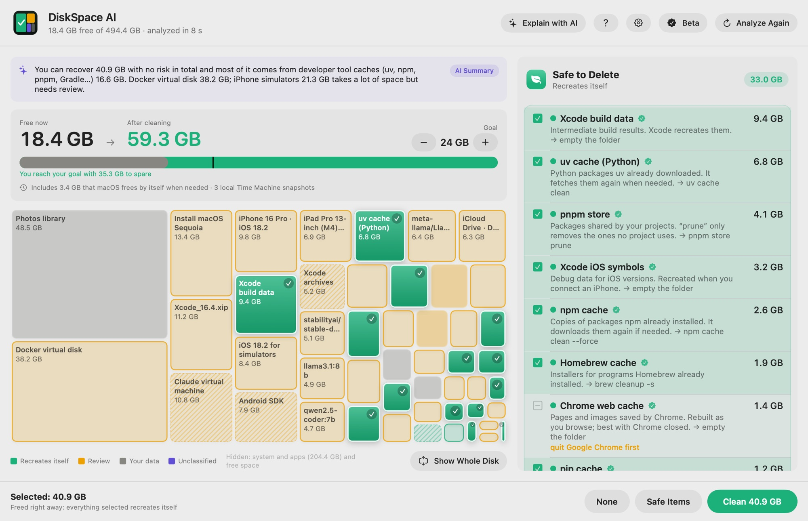

<h1 align="center">DiskSpace AI</h1>

<b>Free up space on your Mac without fear.</b> 
It tells you what every folder is and only selects what recreates itself. Your files are kept for 7 days, in case you change your mind.

  
  
  
  

  <a href="https://diskspaceai.com/"><b>Website</b></a> ·
  <a href="https://diskspaceai.com/beta"><b>Download the beta</b></a> ·
  <a href="https://diskspaceai.com/#demo">Interactive demo</a> ·
  <a href="mcp/README.md">For AI agents (MCP)</a> ·
  <a href="README.es.md">Español</a>

This repository is DiskSpace AI's **public documentation**: the catalog of folders the app knows, how to connect it to your AI agent, the release notes, and the place to report bugs or request features. The app itself is not open source.

## What it does

- **It knows what every folder is.** uv, npm, pnpm and Homebrew caches, Xcode build data, node_modules from idle projects, Docker, AI models, simulators, installers you already used… The ones it doesn't know are explained by Apple's AI, on your Mac.
- **Four colors, one rule.** Green recreates itself and comes selected; amber is for review; gray is your data and is only shown; purple is unclassified.
- **With a safety net.** What recreates itself is deleted right away; your files are set aside for 7 days and can be restored.
- **Duplicate and similar photos.** In your Photos library and your folders: exact duplicates, near-identical shots (Apple's Vision picks the best one, on your Mac), old screenshots, big videos and bursts.
- **Archive instead of delete.** What you don't use but want to keep goes into a .zip that's fully verified before the original is set aside.
- **An Explorer with sizes.** A folder tree and a table sorted by size, with Quick Look and a filter: what Finder doesn't show you.
- **Honest numbers.** APFS clones and hard links are counted once, and Docker shows what it really takes up.
- **For your AI agent.** Claude Code, Claude Desktop, Codex or Cursor can analyze the disk and propose a cleanup; they always ask before cleaning. [How to connect it](mcp/README.md)
- **Your files never leave your Mac.** No analytics or tracking.

## Download

[DiskSpace AI 1.0.15 for Mac](https://diskspaceai.com/download) · macOS 15 or later · Apple silicon and Intel. During the beta, Pro is free until December 31, 2026. Install steps on [the beta page](https://diskspaceai.com/beta).

The app updates itself. What changes in each version is in [CHANGELOG.md](CHANGELOG.md).

## In this repository

| | |
|---|---|
| [folders/README.md](folders/README.md) | The folders the app knows: what each one is, whether you can delete it and how (also as [JSON](folders/folders.json)) |
| [mcp/README.md](mcp/README.md) | Connect DiskSpace AI to your AI agent (MCP server) |
| [CHANGELOG.md](CHANGELOG.md) | Release notes for every version |
| [Issues](../../issues) | Report a bug or request a feature |

## Help and contact

- FAQ and pricing: [diskspaceai.com](https://diskspaceai.com/)
- Support: support@diskspaceai.com
- Bugs and suggestions: [open an issue](../../issues/new/choose)

The folder catalog and documentation are licensed under CC BY 4.0 (see LICENSE). DiskSpace AI is not affiliated with Apple. Mac and macOS are trademarks of Apple Inc.
